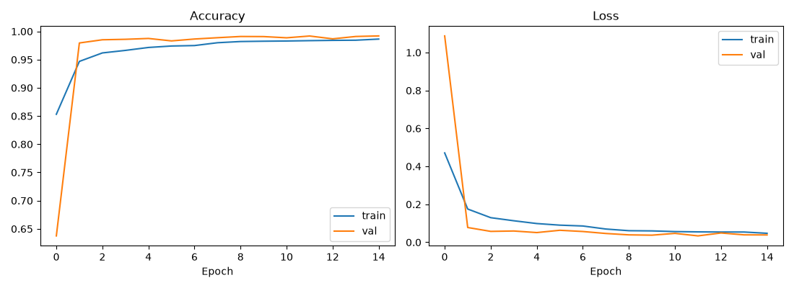
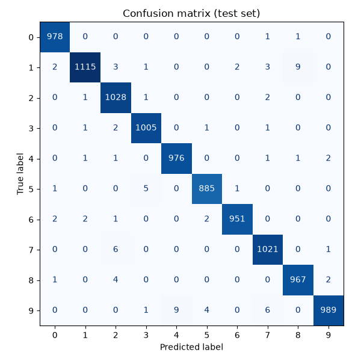
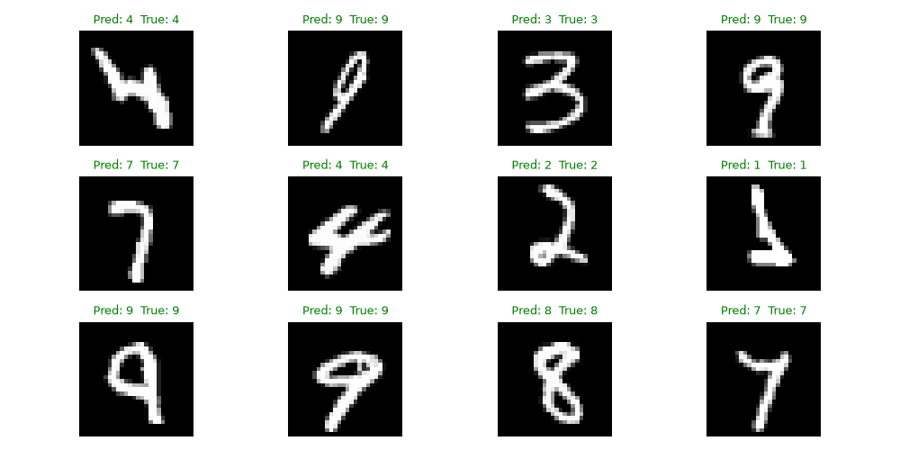

# Handwritten Digit Recognition


A deep-learning project that recognizes handwritten digits using a Convolutional Neural Network (CNN) trained on the MNIST dataset with Keras. It includes a desktop app where you can draw digits or open an image and get predictions for a single digit or a complete multi-digit number.


## Features

- CNN built with Keras / TensorFlow, reaching **99.10% test accuracy** on MNIST
- Data augmentation (rotation, zoom, shift) for better generalization
- **Single-digit mode**: shows the prediction with the top-3 confidences
- **Multi-digit mode**: segments each digit and reads the full number (e.g. `2048`)
- Draw with the mouse, or load an image file
- Trains automatically on first run and saves the model to `mnist_cnn.keras`

## Results

| Metric | Value |
|---|---|
| Test accuracy | 99.10% |
| Test loss | 0.0274 |
| Dataset | MNIST (60,000 train / 10,000 test) |

| Training curves | Confusion matrix |
|---|---|
|  |  |



## Project structure

```
handwritten-digit-recognition/
├── app.py                # Desktop app (single + multi-digit)
├── train.py              # Model training and evaluation charts
├── mnist_cnn.keras       # Trained model
├── images/               # Result charts and screenshots
├── requirements.txt
├── LICENSE
└── README.md
```

## Installation

```bash
git clone https://github.com/<your-username>/handwritten-digit-recognition.git
cd handwritten-digit-recognition

python -m venv env
# Windows:   env\Scripts\activate
# Mac/Linux: source env/bin/activate

pip install -r requirements.txt
```

Tkinter is included with standard Python installers. On some Linux systems you may need `sudo apt install python3-tk`.

## Usage

**Run the app** (uses the included trained model):

```bash
python app.py
```

- Choose **Single digit** or **Multiple digits**, draw on the canvas, then click **Predict**.
- **Open Image...** recognizes digits from a picture file.
- **Retrain Model** trains a new model from scratch.

**Retrain the model and regenerate the charts:**

```bash
python train.py
```

## Model architecture

```
Input (28x28x1)
-> RandomRotation / RandomZoom / RandomTranslation (training only)
-> Conv2D(32, 3x3) -> BatchNorm -> MaxPool
-> Conv2D(64, 3x3) -> BatchNorm -> MaxPool
-> Flatten -> Dense(128, ReLU) -> Dropout(0.4)
-> Dense(10, Softmax)
```

Optimizer: Adam (1e-3) with learning-rate reduction on plateau. Early stopping on validation accuracy.

## How multi-digit recognition works

1. Convert the image to white-on-black and binarize it.
2. Find each connected blob of ink and sort the blobs left to right.
3. Crop, scale and center each digit in MNIST style (28x28).
4. Classify every digit with the CNN and join the results into one number.

## Limitations and future work

- Digits that touch each other are treated as one blob and will be misread, so leave small gaps between digits.
- Photos with shadows or ruled lines may need cleaning first.
- Possible improvements: better segmentation for touching digits (projection profiles or OpenCV), and a web version using Streamlit or Flask.

## License

This project is licensed under the MIT License. See the [LICENSE](LICENSE) file for details.

## Author

**Your Name** - [GitHub](https://github.com/<your-username>)
